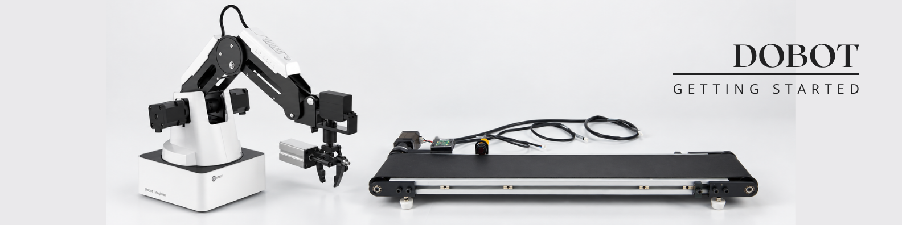

<h1 align="center">
  <a href="#"> 🧩 Dobot Magician </a>
</h1>

  
  </a>

  
  
  

<h4 align="center"> 
   Status: 🚧 Work In Progress <!--✅ Completed-->
</h4>

 <a href="#about">About</a> •
 <a href="#features">Features</a> • 
 <a href="#installation">Installation</a> • 
 <a href="#usage">Usage</a> •  
 <a href="#techstack">Tech Stack</a> • 
 <a href="#roadmap">Roadmap</a> • 
 <a href="#license">License</a> • 
 <a href="#feedback">Feedback</a> • 
 <a href="#author">Author</a>

---

## 🧭 About 
This project provides documentation and examples for controlling the DOBOT Magician through the Python API using DobotStudio.

It includes an overview of the available `dType` functions, their parameters, return values, and practical usage examples.

The documentation is based on the API information available in DobotStudio and is intended to make the functions easier to understand and use in Python projects.

---

## 🚀 Features 
- ✨ Feature 1 — _Short description_
- 🧩 Feature 2 — _Short description_
- ⚙️ Feature 3 — _Short description_
- 📱 Feature 4 — _Short description_

---

## ⚙️ Installation 

Installing DobotStudio
1. Go to dobot-robots.com/service/download-center.
2. Use filters on the left side of the screen to find the software (Products: Magician | Data Type: Control Software).
3. You should find DobotStudio (DOBOT Magician) v1.9.4. Download this file.
4. Unzip and install .exe file.
5. You should get promped to install a drive, please install this driver. 
6. Complete the installation.

> If no COM port shows up or the robotarm is not recognised please make sure the driver is installed.
Alternative website: silabs.com/software-and-tools/usb-to-uart-bridge-vcp-drivers

---
## Code Snippets 
---
## Functions 
All functions and its descriptions, return values and parameters can be found here insert file.

---

## 🤝 Contributors 

Thanks to everyone who has contributed to this project!

- **Mauro De Bruyn** – Author / Student – [GitHub](https://github.com/MauroDeBruyn)  
